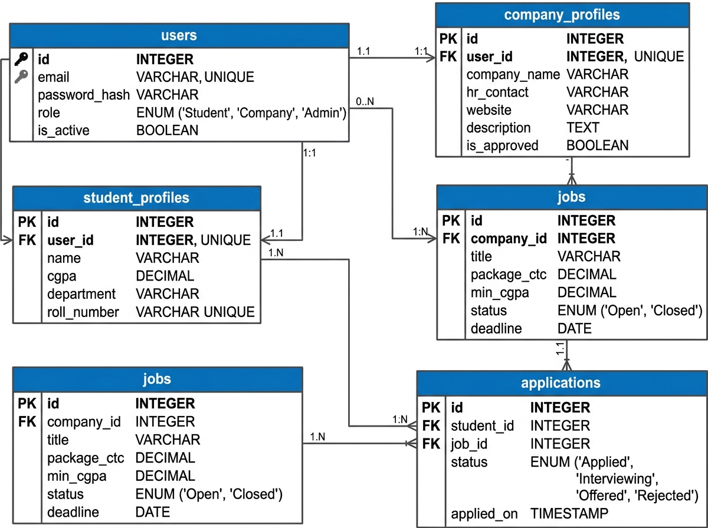
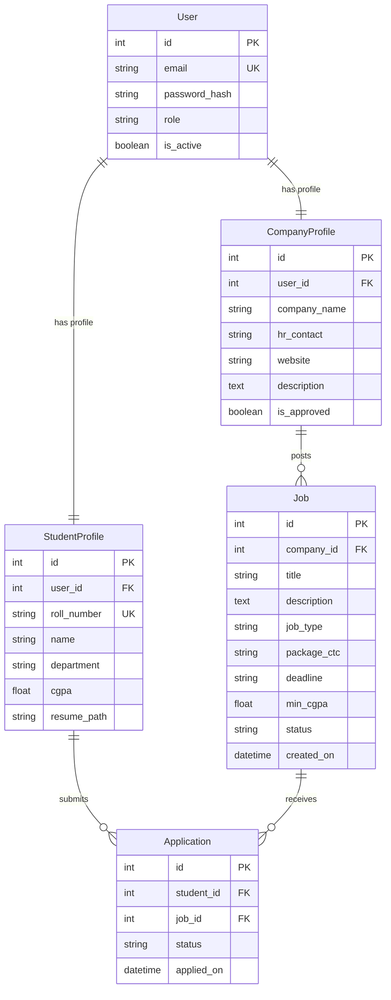

# App Dev Project Report

## 1. Student Details

*   **Name**: Atharva Bacchuwar
*   **Roll Number**: BS22XXXX (Please replace with your actual roll number)
*   **Email**: atharvabacchuwar@onlinedegree.iitm.ac.in (Please replace with your actual email)
*   **About Me**: I am a student in the IIT Madras BS Degree program with a deep interest in full-stack web application development, asynchronous background processing, and building efficient database-driven systems.

---

## 2. Project Details

*   **Project Title**: Placement Portal Application (PPA) - V2
*   **Problem Statement**:
    To design and build a multi-role, responsive web application that streamlines campus recruitment. The application enables **Administrators (Institute)**, **Companies (Recruiters)**, and **Students** to interact seamlessly—automating company verification, placement drive approvals, student eligibility filtering (based on CGPA constraints), real-time application tracking, and asynchronous tasks like data exports and periodic reporting.
*   **Approach**:
    The application is built using a clean separation between the backend REST API (Python/Flask) and the frontend Single Page Application (Vue.js CDN). Database states are tracked using SQLite through SQLAlchemy. To maintain high performance and decouple long-running operations:
    1.  **Redis API Caching** is integrated to cache statistics and public listings, reducing direct database reads.
    2.  **Celery Background Workers** are used to handle asynchronous tasks such as CSV applications history export, sending automated daily email/log reminders, and generating HTML activity reports.

---

## 3. AI/LLM Declaration

I used **Google DeepMind's Antigravity (Gemini)** to assist in refining database schema relationships, designing Vue.js single-page component routing, structuring Celery asynchronous tasks, and refactoring API routes to follow standard RESTful conventions. 
*   The extent of AI/LLM usage is around **15-20%**, limited to **code structure suggestions, logic refactoring, and documentation formatting**.
*   All core business logic, debugging, verification, and integration were done manually.

---

## 4. Technologies and Frameworks Used

| Technology / Library | Purpose |
| :--- | :--- |
| **Flask** | Core backend REST API framework |
| **Vue.js (v3 via CDN)** | Reactive frontend Single Page Application (SPA) structure |
| **Bootstrap 5** | Responsive styling, table design, and dashboard layouts (No other CSS framework used) |
| **SQLite** | Local database engine for storing users, profiles, drives, and applications |
| **SQLAlchemy** | Object Relational Mapper (ORM) for python-to-SQL translation and relationship cascade handling |
| **Redis** | In-memory database used as a broker for Celery and for API response caching |
| **Celery** | Distributed task queue for asynchronous file generation and scheduled cron/beat jobs |
| **Werkzeug** | Secure password hashing (`pbkdf2:sha256`) and verification |

---

## 5. Database Schema / ER Diagram

### Tables:
*   **User**: `id` (Integer, PK), `email` (String, Unique, Indexed), `password_hash` (String), `role` (String: admin/student/recruiter), `is_active` (Boolean)
*   **StudentProfile**: `id` (Integer, PK), `user_id` (Integer, FK), `roll_number` (String, Unique), `name` (String), `department` (String), `cgpa` (Float), `resume_path` (String)
*   **CompanyProfile**: `id` (Integer, PK), `user_id` (Integer, FK), `company_name` (String), `hr_contact` (String), `website` (String), `description` (Text), `is_approved` (Boolean)
*   **Job**: `id` (Integer, PK), `company_id` (Integer, FK), `title` (String), `description` (Text), `job_type` (String: Full-Time/Internship), `package_ctc` (String), `deadline` (String), `min_cgpa` (Float), `status` (String: pending/approved/rejected/closed), `created_on` (DateTime)
*   **Application**: `id` (Integer, PK), `student_id` (Integer, FK), `job_id` (Integer, FK), `status` (String: applied/shortlisted/selected/rejected), `applied_on` (DateTime)

### Relationships:
*   **One-to-One**: `User.id` $\leftrightarrow$ `StudentProfile.user_id`
*   **One-to-One**: `User.id` $\leftrightarrow$ `CompanyProfile.user_id`
*   **One-to-Many**: `CompanyProfile.id` $\rightarrow$ `Job.company_id` (A recruiter can post multiple drives)
*   **One-to-Many**: `StudentProfile.id` $\rightarrow$ `Application.student_id` (A student can apply to multiple drives)
*   **One-to-Many**: `Job.id` $\rightarrow$ `Application.job_id` (A drive receives multiple student applications; deletion of a Job cascades to delete associated applications)

### ER Diagram:

---

## 6. API Resource Endpoints

### 6.1. Authentication (`/api/auth`)
*   `POST /register/student` - Self-register a new Student account.
*   `POST /register/company` - Submit a Recruiter profile for Admin approval.
*   `POST /login` - Authenticate session cookies (handles custom hardcoded administrator account credentials and DB-hashed passwords).
*   `POST /logout` - Invalidate session cookies.

### 6.2. Student Endpoints (`/api/students`)
*   `GET /profile` - Retrieve logged-in student academic details.
*   `PUT /profile` - Update student profile details (e.g. CGPA, Name).
*   `POST /resume` - Upload resume document (.pdf only).
*   `GET /applications` - List jobs applied to by the student.
*   `POST /export-applications` - Triggers asynchronous Celery task to export student application history to CSV. Returns `task_id` with `202 Accepted` status.
*   `GET /export-status/<task_id>` - Polls Celery worker status for completion. Returns download path once CSV export is compiled.

### 6.3. Recruiter Endpoints (`/api/companies`)
*   `GET /dashboard` - Fetch recruiter profile and posted drives.
*   `POST /jobs` - Submit a new placement drive request (marked as `pending` until approved by Admin).
*   `PUT /jobs/<id>` - Modify placement drive details.
*   `DELETE /jobs/<id>` - Permanently delete a placement drive (cascades and deletes applications).
*   `POST /jobs/<id>/close` - Transition job status to `closed`, hiding it from students.
*   `GET /drives/<id>/applications` - Fetch applicant student profiles for a drive.
*   `POST /applications/<id>/status` - Shortlist, select, or reject a student application.

### 6.4. Job & Application Listings (`/api/jobs`)
*   `GET /` - Fetch all Admin-approved placement drives. Checks student CGPA against minimum drive requirements and flags eligibility.
*   `POST /apply/<id>` - Submit a new application to a drive (verifies CGPA and prevents double-application).

### 6.5. Admin Endpoints (`/api/admin`)
*   `GET /stats` - Query total stats (percentage of placed students, registration counts). Caching decorator `@cached_api` applied.
*   `GET /pending-recruiters` - Lists recruiters waiting for verification.
*   `POST /approve-recruiter/<id>` - Authorize recruiter login.
*   `GET /pending-drives` - Lists posted placement drives waiting for approval.
*   `POST /approve-drive/<id>` - Authorize drive visibility to students.
*   `POST /toggle-user-status/<id>` - Enable/disable account access (allows immediate deactivation/blacklisting).
*   `GET /search` - Search students and companies using filters.
*   `GET /drives` - List all drives with live applicant statistics.
*   `GET /drives/<id>/applications` - Admin drill-down view of applicants for any specific drive.

---

## 7. Architecture and Features

### File Structure:
*   `app.py` - Flask API initialization, blueprint registrations, default admin seeding (`admin@iitm.in` / `admin123`), and Celery scheduling definition.
*   `config.py` - Standard settings loader (handles SQLite database URI mapping and Redis configuration with zero `.env` dependencies).
*   `database.py` - Central SQLALchemy engine binding interface.
*   `celery_worker.py` - Celery application runner wrapping Flask context.
*   `/models/` - Declarative model files defining entity attributes and DB mappings.
*   `/routes/` - REST API controllers structured using Flask Blueprints.
*   `/tasks/` - Asynchronous jobs:
    *   `csv_export.py` - Creates CSV report from DB and registers completion logs.
    *   `daily_reminders.py` - Logs alerts for upcoming job deadlines (3-day threshold).
    *   `monthly_report.py` - Saves monthly HTML activity metrics in `backend/uploads/reports/`.
*   `/utils/` - Contains the `@cached_api` decorator caching JSON responses in Redis.
*   `/frontend/` - Static files containing:
    *   `index.html` - Mount entry point for Vue SPA.
    *   `js/app.js` - Client-side router definition.
    *   `js/components/` - Vue dashboard components utilizing Bootstrap.
